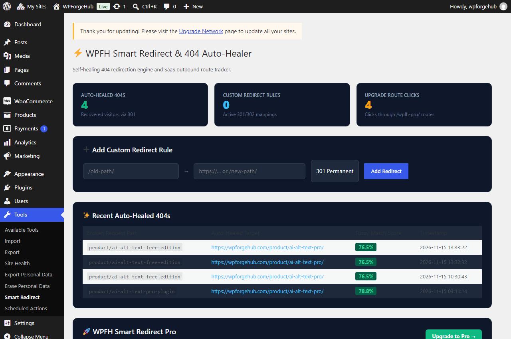

# ForgeHub Smart Redirect

  

**Smart Redirect** transforms dead-end 404 error pages into self-healing, revenue-retaining 301 redirects using fuzzy slug similarity matching.

---

## ⚡ How 404 Auto-Healing Works

When a user visits a mistyped or outdated URL (e.g. `/product/smart-redrect/` instead of `/product/smart-redirect/`):
1. Smart Redirect intercepts the 404 event.
2. It strips known prefixes and compares slug distance (`similar_text`) against all published store products, pages, and blog posts.
3. If confidence is >= 65%, it immediately issues an SEO-friendly 301 Permanent Redirect to the exact matching resource!
4. The auto-heal event is logged in your admin dashboard for audit.

---

## 🚀 Pro Features

* **Automated Slug Change Sentinel**: Detects when posts/products are renamed and auto-creates 301 rules.
* **Regex Wildcard Matching**: Route entire URL structures dynamically.
* **404 Spike Webhooks**: Slack and email notifications when 404s spike.
* **Query Parameter & UTM Preservation**: Carries UTM tags across redirects.

---

## 🔗 Links & Resources

- **Plugin Page:** [https://wpforgehub.com/product/smart-redirect/](https://wpforgehub.com/product/smart-redirect/)
- **Documentation & Help:** [wpforgehub.com/docs](https://wpforgehub.com/docs/)
- **More Free WordPress Plugins:** [wpforgehub.com](https://wpforgehub.com/#products)

---

## 📄 License

GPLv2 or later &copy; [WPForgeHub](https://wpforgehub.com).

---

## 📸 Admin Preview

  

